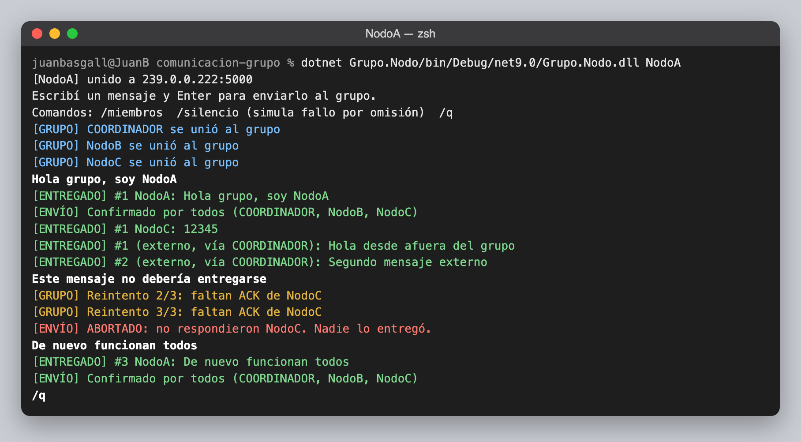
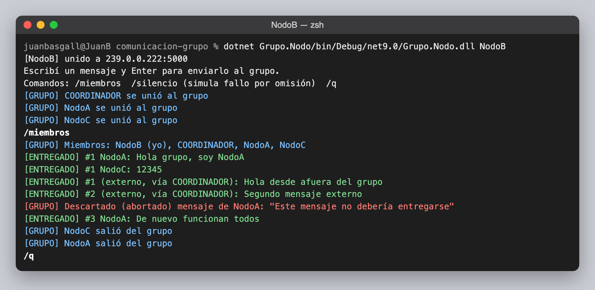
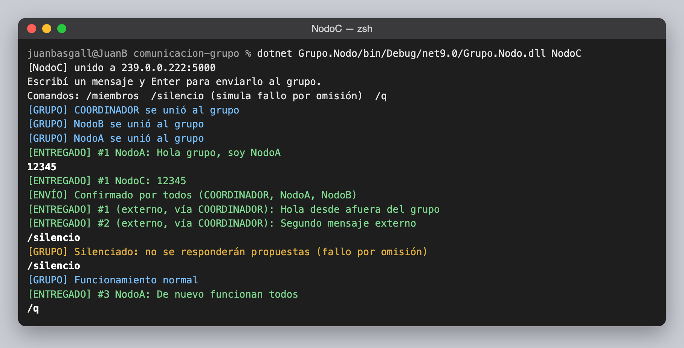
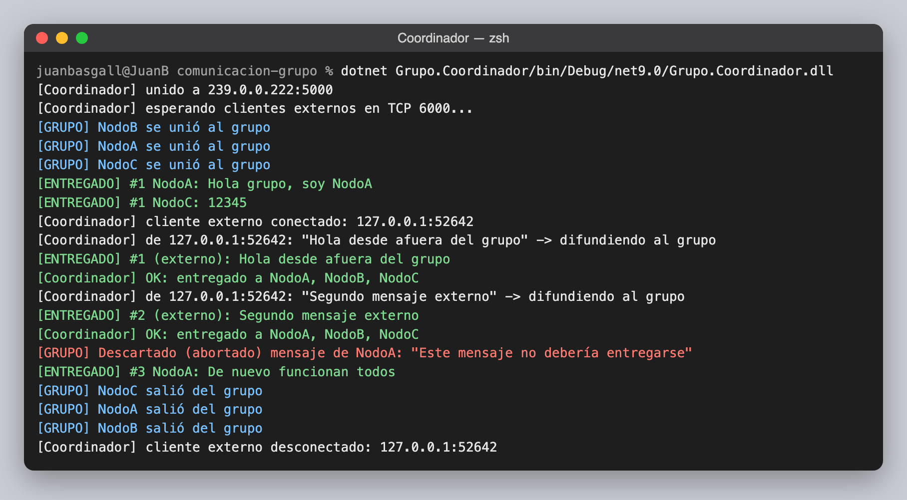
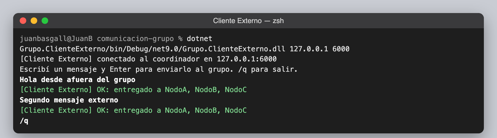

# TP Comunicación en Grupo — Sistemas Distribuidos

## Introducción

En un sistema distribuido, un **grupo** es un conjunto de procesos que actúan juntos: cuando se envía un mensaje *al grupo*, lo reciben todos sus miembros. A diferencia de la comunicación puntual (un emisor, un receptor), la comunicación en grupo es **uno a muchos**, y se usa para replicar servicios, propagar eventos o descubrir servidores.

Para implementarla se usó **IP multicast**: el emisor manda un único datagrama UDP a una dirección de clase D (rango 224.0.0.0 – 239.255.255.255) y la red se lo hace llegar a todos los que se unieron a esa dirección. El grupo usa la dirección **239.0.0.222, puerto 5000**. Su problema es que UDP **no garantiza la entrega**: ante un fallo por omisión, algunos miembros reciben el mensaje y otros no. Por eso el TP pide **atomicidad**: que el mensaje llegue a **todos o a ninguno**.

## Arquitectura

La solución está en C# (.NET 9) y tiene cuatro proyectos:

| Proyecto | Rol |
|---|---|
| `Grupo.Common` | Formato del mensaje, configuración de red y la clase `NodoGrupo`, que implementa el protocolo |
| `Grupo.Nodo` | Miembro del grupo: envía y recibe mensajes por multicast |
| `Grupo.Coordinador` | Miembro del grupo y única puerta de entrada para procesos externos (TCP 6000) |
| `Grupo.ClienteExterno` | Proceso fuera del grupo (la "cuarta computadora"): le habla al coordinador por TCP |

Es un **grupo cerrado con coordinador**: los nodos se comunican entre sí directamente por multicast (como un grupo de pares). Quien está afuera no se une al grupo: envía sus mensajes al coordinador y él los difunde.

### Atomicidad: compromiso en dos fases

1. **Propuesta.** El emisor multidifunde el mensaje con un número de secuencia. Cada miembro lo guarda como *pendiente* (todavía no lo muestra) y responde con un **ACK**.
2. **Confirmar o abortar.** Si llegan los ACK de **todos** los miembros, el emisor multidifunde **CONFIRMAR** y todos entregan el mensaje. Si falta alguno después de 3 reintentos, multidifunde **ABORTAR** y todos lo descartan: nadie lo entrega.

Los reintentos y los identificadores únicos de cada mensaje evitan duplicados cuando se pierde un datagrama.

### Membresía

Cada miembro multidifunde un latido (`Presente`) por segundo. Así cada nodo sabe quién está en el grupo: detecta altas ("se unió"), bajas voluntarias ("salió", con un mensaje `Salida`) y caídas (si un miembro no late durante 4 s, se lo considera caído).

## Ejercicios

**Ejercicio 1 — Sistema multicast con atomicidad y coordinador.** Implementado con el protocolo descrito arriba. Para probar la atomicidad, el comando `/silencio` hace que NodoC siga vivo en el grupo pero deje de responder propuestas, como si perdiera los mensajes (fallo por omisión). Entonces NodoA no recibe el ACK de NodoC y aborta el envío. El coordinador y NodoB descartan ese mensaje y **ningún** miembro lo entrega. Cuando NodoC vuelve a funcionar, los envíos se confirman otra vez.

**Ejercicio 2 — Grupo de tres nodos.** Se levantan NodoA, NodoB y NodoC sobre la misma dirección de grupo. NodoA envía una cadena ("Hola grupo, soy NodoA") y NodoC un entero (12345). Los dos mensajes se entregan en todos los miembros.

**Ejercicio 3 — Cuarta computadora externa.** El Cliente Externo se conecta al coordinador por TCP y envía dos mensajes. El coordinador los difunde de forma atómica al grupo, los tres nodos los reciben marcados como *externos*, y el cliente recibe la confirmación `OK: entregado a NodoA, NodoB, NodoC`.

## Capturas

**NodoA:** ve unirse al resto, envía un mensaje confirmado por todos, recibe los mensajes de NodoC y del cliente externo, y ve abortarse su envío mientras NodoC está silenciado.



**NodoB:** consulta los miembros con `/miembros`, recibe todos los mensajes y descarta el abortado.



**NodoC:** envía un entero. Con `/silencio` simula el fallo por omisión y nunca recibe el mensaje abortado.



**Coordinador:** recibe al cliente externo por TCP y difunde sus mensajes al grupo.



**Cliente Externo:** envía desde fuera del grupo y recibe la confirmación de entrega.



## Cómo ejecutarlo

Hace falta el SDK de .NET 9. Abrí una terminal por proceso:

```bash
dotnet run --project Grupo.Nodo -- NodoA
dotnet run --project Grupo.Nodo -- NodoB
dotnet run --project Grupo.Nodo -- NodoC
dotnet run --project Grupo.Coordinador
dotnet run --project Grupo.ClienteExterno -- <ip-del-coordinador> 6000
```

En macOS, `./abrir-demo.sh` compila y abre las cinco ventanas automáticamente. Comandos de los nodos:
- `/miembros`: lista los miembros del grupo.
- `/silencio`: activa o desactiva el fallo por omisión simulado.
- `/q`: sale del grupo.

## Conclusiones

IP multicast permite enviar un mensaje a un grupo con un solo datagrama, pero por sí solo no garantiza que llegue a todos. Con ACKs, reintentos y un compromiso en dos fases se consigue la entrega atómica: el mensaje lo entregan todos o ninguno. El costo es más tráfico y más demora por cada mensaje. Además, el protocolo depende de que el emisor no se caiga entre las dos fases: si se cae, los miembros descartan el mensaje pendiente por timeout. La membresía por latidos permite saber a quién hay que esperar. El coordinador separa a los procesos externos del grupo y es el único punto de entrada para ellos.
